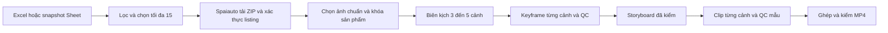

# Kiến trúc chuẩn PI → MP4

> Tài liệu này mô tả thiết kế creative của pilot. Kiến trúc nền tảng, Spark Intake, lịch chạy và quyền sở hữu dữ liệu được đề xuất trong [Product Automation Platform Blueprint](platform/01-executive-summary.md).

Ngày chốt tài liệu 2026-11-03, Asia/Bangkok. Đây là **kiến trúc đích**. README mô tả lệnh đang chạy được. [Lộ trình](BUILD-SEQUENCE.md) ghi phần cần triển khai và điều kiện nghiệm thu.

## 1. Luồng duy nhất

Mặc định 4 cảnh. Biên kịch có thể chọn 3 hoặc 5 nếu cách kể cần. Số cảnh được pin khi kịch bản hợp lệ. Thời lượng mỗi cảnh lấy từ preset render đã xác nhận. Bản đầu giữ 8 giây/cảnh, tương ứng 24–40 giây. Tổng thời lượng, số frame và trần lượt gọi lấy theo plan đã pin.

## 2. Quyền sở hữu công việc

| Vai trò | Đầu vào | Đầu ra |
|---|---|---|
| Chọn sản phẩm | Danh sách đã kiểm link, trùng lặp và biến thể mâu thuẫn | Tối đa 15 listing kèm lý do |
| Khóa sản phẩm | ZIP đúng listing, ảnh đã lọc và thông tin quan sát | Product Lock và bộ ảnh tham chiếu |
| Biên kịch | Product Lock, ảnh phù hợp và mục tiêu video | Một brief cùng kịch bản 3–5 cảnh |
| QC hình ảnh | Product Lock, yêu cầu của cảnh và ảnh hoặc frame mẫu | Kết quả theo từng đặc điểm bắt buộc |

Một Python runner điều phối các vai trò, quản lý file, checkpoint, quota và Send. Các vai trò có thể dùng chung model và router. Spaiauto lấy nguồn, Flow sinh ảnh và clip, FFmpeg xử lý media. Storyboard được ghép từ kịch bản và keyframe đã duyệt bằng dữ liệu sẵn có.

Antigravity là phương án thử biên kịch có giám sát. Agent nhận lock và ảnh đã chọn, trả kịch bản theo cùng schema để runner kiểm trước khi nhận. Khi tự động hóa, dùng route thực sự đã xác nhận hỗ trợ model và JSON. Gemini 3.6 Flash là ứng viên cho kịch bản và vision QC. Chọn model sau khi thử trên ảnh thật và xác nhận quyền truy cập của tài khoản. [Gemini 3.6 Flash](https://ai.google.dev/gemini-api/docs/models/gemini-3.6-flash) · [Antigravity](https://antigravity.google/docs/models)

## 3. Hợp đồng dữ liệu đích

| Artifact | Nội dung tối thiểu |
|---|---|
| Nguồn | Listing ID, variant yêu cầu, tab/dòng, thời điểm thu thập, ZIP/capture, ảnh và SHA |
| Product Lock | Listing và variant đã xác minh, ảnh tổng thể, ảnh chi tiết, danh sách đặc điểm có ID và ảnh chứng minh, mức chắc chắn |
| Kịch bản | Brief, phiên bản schema, lock digest và 3–5 scene có ID ổn định. Mỗi scene có mục đích, hành động, thời lượng, ảnh tham chiếu chính, đặc điểm phải thấy, prompt ảnh và chuyển động |
| Storyboard | Scene theo thứ tự, keyframe đã đạt, SHA, QC và liên kết với phiên bản kịch bản |
| Clip và MP4 | Clip gắn scene ID, kết quả QC mẫu, thứ tự ghép và kết quả kiểm file cuối |

Các artifact đề xuất tái sử dụng quy ước file trong folder sản phẩm. Lưu nguyên liệu, lock, plan, storyboard, keyframe, clip và MP4 cùng cấp. Một SQLite với ba bảng runs/items/operations và một khóa runner. Schema thay đổi có version. Batch cũ tiếp tục đọc plan bốn cảnh đã pin và giữ nguyên nghĩa của receipt cũ.

## 4. QC nhẹ

- **Excel và ZIP.** Lọc link/variant bằng quy tắc rõ, giữ lý do loại. Xác minh ZIP từ đúng kết quả vừa quét. Cách ly ảnh hỏng và bỏ ảnh trùng. Chọn một ảnh tổng thể và ảnh chi tiết khi cần.
- **Lock.** Gắn từng đặc điểm quan trọng với bằng chứng. Khi nguồn mâu thuẫn ở chi tiết nhận diện, yêu cầu xác minh. Chuẩn hóa đơn vị có nghĩa, ví dụ 500 ml và 0.5 L.
- **Kịch bản.** Kiểm số cảnh, ID, reference và đặc điểm phải thấy. Kiểm hành động đối chiếu cấu tạo, chẳng hạn kiểu nắp quyết định cách mở. Chốt các điều kiện này trước khi sinh.
- **Keyframe.** File phải đọc được và an toàn về kích thước. So hình dáng, bộ phận, màu, nhãn và variant theo yêu cầu của cảnh. Khung 9:16 thuộc bước chuẩn hóa để render. Giữ tỷ lệ sản phẩm và vùng có chi tiết cần thấy.
- **Clip.** Lấy mẫu đầu, giữa, cuối và mốc thao tác chính khi cần. Kiểm drift theo cùng Product Lock. Kiểm mẫu chỉ bao phủ các frame đã xem.
- **MP4.** Kiểm thứ tự, duration theo plan, thông số preset và decode đầy đủ.

PASS khi đủ bằng chứng cho chi tiết bắt buộc. FAIL khi thấy sai rõ, ghi mong đợi và quan sát để sửa đúng cảnh. UNKNOWN khi thiếu bằng chứng hoặc kết quả dịch vụ chưa rõ. Kiểm lại ảnh hiện có, xin thêm góc ảnh hoặc chờ dịch vụ tùy nguyên nhân. Ánh sáng, nền và góc máy linh hoạt nếu vẫn nhìn rõ chi tiết cần kiểm.

## 5. Phục hồi và chi phí

Pin danh tính theo listing/variant, plan theo lock và đầu vào generation theo scene, ảnh tham chiếu cùng SHA. Ghi operation và ngân sách trước Send. Sau timeout, đối chiếu operation cũ. Khôi phục file đã duyệt chỉ được poll đúng operation key đã ghi. Lỗi nội dung đã xác nhận mới được tạo lượt khác trong trần, kèm yêu cầu sửa cụ thể.

Dùng trần tổng mỗi sản phẩm và trần từng scene, lưu qua resume/revision. Nếu tăng lên 5 cảnh, kiểm trước ngân sách có đủ lượt đầu cho cả plan. Sửa cảnh nào thì làm mất hiệu lực artifact phụ thuộc cảnh đó. Thay Product Lock ảnh hưởng các cảnh phụ thuộc lock. Trạng thái phải chỉ rõ đang chờ provider, thiếu tư liệu, thiếu cấu hình hay hết hạn mức, kèm bước xử lý tiếp theo.

## 6. Hiện trạng và nghiệm thu

Code hiện khóa 4 cảnh × 8 giây, dùng ảnh tham chiếu đầu cho Flow, kiểm tỷ lệ keyframe trước vision và chỉ kiểm kỹ thuật clip. [Audit có bằng chứng](QC-AUDIT.md) ghi chi tiết. Luồng đích chỉ đạt khi nghiệm thu đủ các mốc ở [lộ trình](BUILD-SEQUENCE.md), gồm MP4 thật từ listing thật, kiểm drift, và resume không Send trùng.
