# PI/VF · Sổ tay dự án và onboarding

**Mốc đối chiếu:** 08/11/2026, giờ Bangkok. **Độc giả:** PM, người vận hành, dev mới và coding agent.

## 0. Đọc trước khi nhận việc

- **Quyết định hiện hành:** xử lý **tuần tự, từng sản phẩm một** trong một đợt ngày. Giữ workflow riêng cho từng sản phẩm để lỗi của A có lý do và trạng thái riêng, rồi tiếp tục B khi bước của B còn khả thi. Phương án chạy đồng thời ba project đã được thảo luận và để ngoài phạm vi hiện tại.
- **Trạng thái release:** chưa nghiệm thu luồng hằng ngày trên `9863eeb`. PI trả `exchange_batches`, còn đường `Run.ps1 trigger` đọc `exchange_batch_dir`. Consumer riêng chưa được nối và còn lỗi ghim gói. Đồng thời cần xử lý việc thu hồi slot khi Flow chưa rõ kết quả. Xem mục 6 để biết lỗi nào đã tái hiện.
- **Checkout cần phân biệt:** scheduler dùng `D:\work\pi-vf-next`. Worktree `daily-product-flow` là nơi thử nghiệm, có HEAD và diff khác. Các dòng code trong mục lỗi được đối chiếu trên checkout vận hành. Hãy xác nhận vị trí và Git trước khi chỉnh sửa hoặc báo kết quả.
- **Điều kiện báo xong:** source mới phải nằm đúng checkout, test offline phải đi qua entrypoint hằng ngày, và trạng thái xuất thành công cần có receipt và MP4 của chính lượt đó. Test plan, điểm QC, exit code 0 hoặc một MP4 cũ chỉ là bằng chứng ở phạm vi tương ứng.

```powershell
Get-Location
git rev-parse --short HEAD
git status --short
git worktree list
```

Khi bàn giao, ghi rõ checkout, commit/diff, lệnh đã chạy, kết quả thực tế và phần chưa xác minh. Dùng test fake/mock với dữ liệu tạm trong vòng phát triển. Chỉ chạy provider thật hoặc đổi lịch khi tác vụ có yêu cầu vận hành.

## 1. Dự án trong một phút

PI/VF giúp một người vận hành có khoảng **60–90 phút mỗi ngày** tạo video AI dọc cho nội dung TikTok/affiliate. Người dùng đưa danh sách sản phẩm vào Google Sheets. Pipeline chọn sản phẩm, lấy ảnh từ trang bán hàng, viết và dựng video. Người dùng xem MP4 và quyết định video nào dùng được.

**Mục tiêu vận hành:** thường xuyên có khoảng **2–5 video dùng được/ngày**, giảm số phút thao tác tay trên mỗi video duyệt đạt. Đây là mục tiêu sản phẩm, chưa phải năng suất đã đo. Trong thiết kế đích, mỗi sản phẩm đủ đầu vào có workflow riêng và được xử lý tuần tự. Lỗi có thể sửa thì tạo lại đúng ảnh hoặc cảnh lỗi. Hết quota thì ghi lý do và tiếp tục phần còn khả thi, kể cả ghép/xuất video đã đủ clip.

| Trong phạm vi | Ngoài phạm vi release đầu |
| --- | --- |
| Sheet → ảnh local → kịch bản → keyframe → clip → MP4 và báo cáo | Đăng TikTok/Facebook tự động, affiliate link automation, top-K, TTS/nhạc riêng |
| Giữ nhận diện sản phẩm, kiểm lỗi có hành động sửa, người dùng duyệt MP4 | Agent tự chọn công cụ, viết lại PI/VF, gộp database hoặc thêm framework |
| Tối đa hai lần tạo lại **đề xuất** cho mỗi ảnh/clip lỗi đã xác nhận | Ép đủ số sản phẩm mới bắt đầu VF, chấm điểm sáng tạo làm điều kiện release |

Thiết kế mới hướng tới QC có hành động cụ thể. Hệ thống hiện vẫn có chế độ QC và preproduction observe. Dữ liệu observe và verdict là công cụ chẩn đoán, có thể giữ để so sánh trong giai đoạn chuyển tiếp.

## 2. Trạng thái để PM ra quyết định

| Phạm vi | Bằng chứng tại mốc đối chiếu |
| --- | --- |
| Checkout vận hành | `D:\work\pi-vf-next`, nhánh `codex/unified-pipeline`, HEAD `9863eeb`. Có thay đổi chưa commit ở creative/QC/reporting. Khi tái hiện lỗi, ghi cả commit lẫn trạng thái working tree. |
| Checkout thử nghiệm | `C:\Users\ninak\.codex\worktrees\daily-product-flow\pi-vf-next`, detached tại `8e84878`, có sửa local publisher PI và test. Consumer trong `9863eeb` chưa có trong checkout này. |
| Đã có bằng chứng Sheet/CSV → MP4 | Có kiểm chứng offline bằng fixture và MP4 từ các đợt thật trước đó. Các file trong thư mục export gồm nhiều lượt chạy. Đếm file ở đó không cho biết sản lượng của đợt hiện tại. |
| Chạy thật 08/11 | Lượt tuyển đầu có 5 sản phẩm đạt trên 15. Lượt bổ sung có 10 đạt trên 15. VF bắt đầu gói đầu 5 sản phẩm và xuất **0/5 MP4 mới** trong lượt được kiểm tra. Gói tiếp theo chưa được chạy trong lượt đó. |
| Lịch hiện có | Task **PI-VF Two Sheets 0630**, bật, chạy 06:30 giờ Bangkok từ `D:\work\pi-vf-next`, có `--acquire --limit 4 --scenes 4 --qc-level high`. Chính sách phiên trùng là `IgnoreNew`. Lượt scheduler 08/11 có mã thoát 1. |
| Release | **Chưa đạt điều kiện vận hành hằng ngày tự động.** Commit `9863eeb` có các phần của thiết kế mới nhưng còn lỗi nối production và chưa có bằng chứng A/B/C chạy qua entrypoint hằng ngày. |

Hai file báo cáo ngày 07/11 và 08/11 có điểm preproduction và chi phí từ receipt. Kiểm tra thư mục export tại mốc này chưa thấy `human_verdict.json`. Mốc 10–15 verdict là kế hoạch thu mẫu, chưa có căn cứ để kết luận QC tương quan với đánh giá người dùng.

## 3. Kiến trúc nhìn từ một sản phẩm

```mermaid
flowchart LR
    A["Google Sheets"] --> B["PI: snapshot, chọn sản phẩm"]
    B --> C["Spaiauto: ZIP, ảnh local, review"]
    C --> D["Exchange: manifest, ảnh, READY"]
    D --> E["VF: research pack, kịch bản, prompt"]
    E --> F["Storyboard và keyframe"]
    F --> G["Render clip từng cảnh"]
    G --> H["Ghép, kiểm kỹ thuật, xuất MP4"]
    H --> I["Báo cáo ngày và người dùng duyệt"]
```



Sơ đồ mô tả các bước nghiệp vụ. Đường nối giữa gói PI và scheduler VF đang có lỗi trong commit mới. Xem mục 6 trước khi chạy live.

| Bước | Input → output | Quyết định | Điểm đọc code |
| --- | --- | --- | --- |
| Khởi chạy | Tham số CLI hoặc Windows Task Scheduler → ngày Bangkok, limit, profile, mode, kết quả | Quy tắc | `Run.ps1`, `automation/cli.py:298`, `automation/scheduler/daily_trigger.py:156` |
| Chọn sản phẩm | Hai snapshot XLSX → candidate pool → selection CSV/JSON, ID, nguồn và nháp ý tưởng | 9Router chọn trong tập ứng viên hợp lệ. Code kiểm tra ID, trạng thái và số lượng | `apps/pi/tools/sheet_daily.py:25`, `sheet_selection_agent.py:61`, `selection_handoff.py` |
| Thu ảnh | URL sản phẩm → Spaiauto ZIP → ảnh giải nén, capture và review | Browser theo quy tắc. Vision review ảnh local và xác minh nhận diện. Dòng giá/biến thể mơ hồ có thể cần người xem | `apps/pi/tools/spaiauto/scheduled.py:55,101`, `workflow.py:104` |
| Bàn giao | Dòng đạt → manifest, bằng chứng, ảnh local và cờ `READY` | Quy tắc. Cờ `READY` đánh dấu gói hoàn chỉnh. Giữ nguyên gói sau khi phát | `apps/pi/tools/spaiauto/workflow.py:313`, `apps/vf/src/video_factory/automation/importer.py:160,235` |
| Chuẩn bị VF | Sản phẩm, ảnh và profile → resource pack, brief, script, prompt từng cảnh | AI tạo nội dung theo schema/profile. Điều phối và gate theo code | `apps/vf/src/video_factory/automation/creative_cli.py`, `automation/coordinator.py` và `creative/agents/` trong package VF |
| Tạo hình và clip | Storyboard → keyframe → clip theo scene, kèm ID và digest | Provider tạo media. Worker, trạng thái, quota, retry và QC theo policy | `apps/vf/src/video_factory/handlers/_base.py`, `integrations/keyframe_provider_factory.py`, `integrations/scene_renderer.py` trong package VF |
| Xuất | Clip đã có → timeline, MP4, metadata và biên nhận | Composer và transcode theo quy tắc. Bước TikTok export có mặc định 1080×1920, 30fps. Kiểm file thật khi nghiệm thu | `apps/vf/src/video_factory/integrations/composer.py`, `tiktok_export.py:40` |
| Duyệt và đo | MP4, receipt, intake → báo cáo ngày và verdict | Người dùng quyết định approve/reject. CLI tổng hợp điểm và nguyên nhân | `automation/daily_report.py:180`, `automation/human_review.py:46,147` |

**Ranh giới ứng dụng.** PI sở hữu nguồn, dữ liệu thu thập và ảnh. Exchange là giao kèo file giữa PI và VF. VF sở hữu workflow, jobs, artifacts, QC, provider operation và export. `automation/` nối hai ứng dụng và ghi báo cáo. Một repo có thể chứa cả hai ứng dụng với môi trường Python, SQLite và schema riêng.

**Workflow và AI.** Đây là quy trình điều phối có trạng thái bền vững, có các bước gọi AI theo vai trò. AI có thể chọn ứng viên, soạn kịch bản hoặc gợi ý sửa. Quyết định bước kế tiếp, quyền gửi, lưu trạng thái và resume thuộc code. Legacy Discovery và các lệnh cũ có chức năng riêng. Luồng Sheet mặc định đi qua `select_from_pool`; chưa có căn cứ để nói đã gỡ Legacy Discovery.

**Đơn vị công việc.** Candidate ID xác định listing đầu vào. Canonical product key xác định danh tính sản phẩm chuẩn hóa. Product key là SHA-256 của canonical key. Batch ID xác định gói bàn giao, run ID xác định một lượt điều phối, workflow ID xác định trạng thái riêng của sản phẩm. Provider operation ID/project URL xác định yêu cầu đã gửi. Dùng đúng từng ID khi đối soát, dedupe hoặc resume.

**Nơi workflow lưu trạng thái.** SQLite VF giữ trạng thái tổng hợp, events, lệnh đã xử lý và outbox. Worker nhận job bằng lease có thời hạn. Việc một lease hết hạn khác với việc provider đã xác nhận kết quả. Biên nhận provider và digest của artifact giúp kiểm tra retry đang làm trên đúng yêu cầu và đúng dữ liệu. Điểm đọc: `workflows/repository.py:25`, `workflows/outbox_repository.py`, `storage_infra/sqlite.py` trong package VF.

## 4. Runtime, cấu hình và cách vào dự án

| Cần tìm | Vị trí tính từ checkout vận hành |
| --- | --- |
| Snapshot theo ngày và candidate pool | `runtime/pi/sheet_daily/<date>/`, `runtime/pi/sheet_daily/candidate_pool.csv` |
| Lý do PI bỏ qua, ảnh local, capture/review | `runtime/pi/sheet_daily/pi_runs/<selection_id>/intake.json` và thư mục `rows/` cùng run. Xem capture, contact sheet, review nếu có |
| Gói đầu vào VF | `runtime/exchange/inbox/<date>/run_*/`, gồm `manifest.json`, `READY` và ảnh tương đối |
| Scheduler và database | `runtime/scheduler_ledger.json`, `runtime/pi/sheet_daily/pi_snapshots.db`, `runtime/vf/hermes.db` |
| Project, clips và export | `runtime/vf/workspace/projects/`, `runtime/vf/workspace/exports/export_*/`. Xem `final.mp4` và `metadata.json` cùng thư mục |
| Báo cáo và đánh giá người dùng | `runtime/reports/<date>.json`, `human_verdict.json` cạnh export |

**Dev mới.** Đọc [AGENTS](../AGENTS.md), [Migration Roadmap](platform/08-migration-roadmap.md) và [Master Prompt](platform/MASTER-PROMPT.md). Dùng hai môi trường riêng theo [README](../README.md). Từ `apps/pi`, đồng bộ `uv sync --frozen --extra test`. Từ `apps/vf`, đồng bộ `uv sync --frozen --extra dev`. Test bằng dữ liệu tạm, fixture, mock hoặc provider fake. Với test tích hợp, chỉ rõ các đường dẫn runtime tạm và xác nhận module thực sự được import từ checkout đang kiểm thử.

```powershell
# Trong apps/pi
uv run pytest -q tests/test_selection_publish.py tests/test_sheet_daily.py tests/test_spaiauto_import.py

# Trong apps/vf
uv run pytest -q tests/test_creative_batch_entrypoint.py tests/test_worker_pause_scope.py tests/test_export_integrity.py
```

**Vận hành.** Từ root checkout vận hành, xem lệnh `Run.ps1 status`, `Run.ps1 find-mp4` và `Run.ps1 doctor`. Xem trạng thái ngày trước khi dùng `trigger` hoặc `resume`. Lệnh theo lịch ở mốc đối chiếu:

```powershell
.\Run.ps1 trigger --acquire --limit 4 --scenes 4 --qc-level high
```

Đây là cấu hình đang vận hành, có thể gọi browser và provider thật. Dùng fixture trong kiểm thử. `--limit` trên luồng Sheet giới hạn số ứng viên được chọn, tối đa 15 ở bộ chọn. Tại VF, giới hạn áp vào số sản phẩm được nhận để xử lý theo entrypoint tương ứng. Cả hai đều không phải số MP4 bảo đảm hoặc số luồng song song. `--scenes` nhận 3, 4 hoặc 5.

```powershell
.\Run.ps1 human-verdict "<export_dir>" --verdict approve --cause script --reason "POV tốt"
.\Run.ps1 compare-qc --threshold 80
```

Các cause hiện hỗ trợ `script|render|product|other`. Verdict cũ thiếu cause hiển thị `unknown`. Tách `script+product` để đánh giá critic tiền kỳ, và `render+other` để đọc vấn đề đầu ra. Xem rubric version trước khi gộp điểm. Chi phí ngày là tổng từ receipt có ghi nhận. Chi phí provider thiếu receipt có thể chưa nằm trong số đó. Configured run ghi báo cáo ngày và có đường gửi Telegram nếu đã có cấu hình. Khi chia sẻ artifact, che dữ liệu xác thực và giữ nguyên receipt gốc trong runtime.

**Khi thiếu MP4:** tìm sản phẩm trong báo cáo ngày và intake trước. Nếu đã có `READY` nhưng chưa có workflow, kiểm tra bàn giao và admission. Nếu workflow dừng ở keyframe/clip, kiểm operation ID, trạng thái và lý do trước khi resume. Nếu có workflow `completed` nhưng report của lượt hiện tại thiếu file, đối chiếu receipt và MP4 trên đĩa theo đúng run. Báo cáo ngày hiện lưu status, stage, file path và reason. Chi tiết như `next_step` hoặc operation ID có thể cần tra thêm. Điểm đọc: `automation/daily_report.py:52,180`, `automation/pipelines/spark_pipeline.py:236`.

## 5. Chính sách lỗi và vận hành cần giữ

| Tình huống | Hành động dự kiến trong flow mới |
| --- | --- |
| PI thiếu ảnh đúng sản phẩm hoặc thiếu bằng chứng nhận diện | Ghi lý do trong intake và chuyển dòng kế tiếp. Mở ảnh local, review và capture khi điều tra. Giữ cờ `retryable` riêng với quyết định tự retry |
| Keyframe xác nhận hỏng | Tạo lại keyframe lỗi. Dùng digest/conditioning để xác định các clip cần tạo lại. Giữ artifact chưa bị ảnh hưởng |
| Clip xác nhận hỏng | Giữ keyframe hợp lệ, sửa đúng prompt nếu cần, render lại clip lỗi. Ghép từ các clip đã được chấp nhận |
| MP4 ghép hoặc export lỗi | Chạy lại phần ghép/xuất với clip hiện có, không phát sinh yêu cầu AI chỉ vì lỗi ghép |
| Hết quota đã xác nhận | Ghi provider và mã lý do, kết thúc phần cần quota trong lượt. Cho công việc local đủ đầu vào tiếp tục |
| Tạm hết slot hoặc rate limit | Ghi trạng thái chờ/giới hạn theo provider. Phân biệt với hết quota. Tôn trọng slot, không biến mỗi lần poll thành lượt tạo mới |
| Timeout sau khi gửi, chưa rõ kết quả | Giữ operation ID và URL, đối soát yêu cầu cũ. Giữ phần còn chạy được tiếp tục. Chỉ tạo lần mới sau khi có bằng chứng về trạng thái cũ và policy cho phép |

**QC hiện có và chính sách đích.** Preproduction observe ghi review kèm digest và ngưỡng mặc định 80, không làm cổng PASS cho scene plan. Với policy hiện hành, middle/high có kiểm receipt keyframe ở storyboard; high yêu cầu content review final hiện hành. Cổng final còn yêu cầu technical PASS gắn với SHA. Mục tiêu mới là chuyển việc chấm điểm sáng tạo ra khỏi đường tự động, giữ kiểm kỹ thuật và các lỗi hình ảnh có hướng sửa. Recovery keyframe và clip là hai đường riêng. Một bộ đếm `claim_qc_attempt` giới hạn lượt gửi chưa chứng minh ảnh bị QC loại sẽ tự tạo lại và đi tới MP4.

**Validation kịch bản.** Director yêu cầu `product_interaction`, `start_state`, `end_state`, `environment` và `subject_action`. Khi điều tra `DIRECTOR_REQUIRED_FIELD_MISSING`, xác định cảnh và field bị thiếu để sửa prompt. Luồng chính tiếp tục dùng creative-batch và các job VF. Prototype `AutonomousVideoPipeline` có luồng riêng. Điểm đọc: `creative/agents/director.py:119` trong package VF.

**Chất lượng POV.** Các đợt review trước nêu cảnh trưng bày ít hành động, khó tạo cảm giác trải nghiệm. Thử nghiệm rubric v2 chuyển trọng tâm từ chữ trên màn hình sang hook hình ảnh và trải nghiệm POV. Working tree vận hành có thay đổi scene bible và rubric, cùng bằng chứng review v2 trong báo cáo ngày. Chưa có đủ verdict người để kết luận thay đổi này cải thiện MP4. Điểm đọc: `creative/agents/director.py:16,89` và `creative/agents/critic.py:9,131` trong package VF.

**Đối soát Flow.** Keyframe Flow hiện không có đường poll tự động được adapter tin cậy cho trạng thái mơ hồ. Dùng project/operation cũ và quy trình operator đã có. Fallback clip sang Vertex trong các nhánh đủ điều kiện là đường khác với fallback ảnh keyframe; resolver keyframe của đường Flow đang dùng không chấp nhận Vertex tự động.

Đối với clip, `PUBLIC_ERROR_UNUSUAL_ACTIVITY` là mã từ chối adapter bắt được trong phản hồi gắn với request đã gửi. Code có nhánh Vertex cho cảnh bị từ chối có bằng chứng. Nguyên nhân cụ thể phía Google chưa được xác minh. Ca này cần phân biệt với timeout sau Send và với hết slot. Điểm đọc: `integrations/google_flow_provider.py:486` và `integrations/scene_renderer.py:473,500` trong package VF.

Điểm đọc: `creative_policy.py:9,32`, `handlers/_base.py:1719`, `application/operator_handler.py:311,1476,2435,2644`, `integrations/google_flow_keyframe_provider.py:903,938`, `integrations/keyframe_provider_factory.py:37` trong `apps/vf/src/video_factory/`.

## 6. Lịch sử vấn đề và các lỗi còn mở

| Mốc | Thay đổi hoặc sự cố | Trạng thái tại mốc đối chiếu |
| --- | --- | --- |
| 02–03/11 | Gom source PI/VF, giữ entrypoint và schema, nối CSV/Exchange tới VF, có scheduler và fixture offline | README và báo cáo phase ghi các mốc triển khai. Cutover vận hành thật là điều kiện riêng |
| `d0ddd9b`, tag `pre-live-observe` | Baseline an toàn và observe. Validation field bắt buộc, log/exit code, ledger atomic/lock, reason code, preproduction receipt, daily report, verdict | Kiểm từng tính năng ở code và test. Tag là mốc Git, không chứng minh batch thật chạy ổn định |
| `290d79d` | `no_matching_images` từng xảy ra vì đối chiếu URL ảnh nguồn dù ảnh trong ZIP đọc được. Chuyển scheduled intake sang dùng ảnh local và xóa ZIP sau import | Đã có source và test local ZIP. `identity_unverified` là lỗi khác. Báo cáo từng nhắc `review-failed.json` chứa raw response; chưa thấy đường ghi artifact đó trong source scheduled đã kiểm |
| `8e84878`, tag `pre-pov-rubric-v2` | Checkpoint recovery Flow/Vertex, giữ operation và các tình huống no-resend | Phân biệt recovery đã có với vận hành tự động của batch mới. Một số thay đổi rubric POV còn ở working tree vận hành |
| 08/11, lượt manual | Táo Tàu Đỏ timeout sau khi gửi keyframe đầu. Operation `keyframe-b06968023d4359bad8662759` ở `unknown` tại thời điểm kiểm tra. Kẹo Dừa gặp `PROVIDER_CAPACITY_WAIT` | Run `manual-20261108-10-sel_20261108_c003bfd55020` xuất 0/5 MP4 mới. Lỗi provider cùng cách dừng theo batch làm phần còn lại phải chờ. Trạng thái operation ở đây là ảnh chụp sự cố |
| `9863eeb` | Publisher từng dòng, standalone Exchange consumer và sửa một lớp worker pause | Có code và tài liệu ca A/B/C. Còn các lỗi nối dưới đây, nên chưa nghiệm thu flow mới |

### Các lỗi chặn release trong `9863eeb`

1. **P0 · Handoff chưa nối scheduler.** PI còn đợi `acquire_batch()` và kiểm mọi dòng hết pending rồi mới phát. PI trả `exchange_batches`; scheduler pipeline đọc `exchange_batch_dir`. Standalone consumer chưa được gọi từ luồng ngày. Điểm đọc: `apps/pi/tools/sheet_daily.py:78–100`, `automation/pipelines/spark_pipeline.py:627`.
2. **P0 · Consumer chưa ghim đúng sản phẩm.** Consumer truyền `batch_dir`; CLI đọc `exchange_batch` và có thể lấy gói READY mới nhất. `limit=1` được ưu tiên hơn `product_key`. ID nối tên gói từng dòng với SHA của product có thể vượt giới hạn 96. `provider_mode` nhận vào hàm chưa được đưa vào Namespace. Điểm đọc: `apps/vf/src/video_factory/automation/exchange_consumer.py:39–56`, `creative_cli.py:422–445,462,522` cùng thư mục.
3. **P0 · Quota đang chặn sai phạm vi.** Worker có thể nhận job mới khi chạy một tick chỉ nhắm workflow đang chờ và operation giữ slot thuộc workflow khác. Test offline hiện có tái hiện hồi quy này. Ở hướng ngược lại, coordinator vẫn chặn workflow chỉ còn việc local nếu không có operation đang chạy. Consumer còn suy ra hoàn tất từ exit code 0, trong khi CLI cũng có thể trả 0 cho blocked. Điểm đọc: `workflows/worker.py:52,219–228`, `automation/coordinator.py:2123–2134`, `automation/exchange_consumer.py:58`, `automation/creative_cli.py:756` trong package VF.
4. **P0 · Thu hồi slot có thể giải phóng một operation chưa rõ kết quả.** Tái hiện với SQLite in-memory: keyframe `unknown` 11 phút, lease 30 phút còn hạn. Reclaim đánh dấu `KEYFRAME_TIMEOUT_EXPIRED`, xóa reservation và nhận operation khác trên cùng profile. Code quyết định theo tuổi request, thiếu xác nhận từ provider. Đây là lỗi có từ `8e84878`; tái hiện chứng minh slot được mở sớm, chưa chứng minh đã gửi trùng yêu cầu thật. Cần xử lý trước khi chạy lại provider thật. Điểm đọc: `apps/vf/src/video_factory/integrations/capacity.py:247–290`, `apps/vf/src/video_factory/workflows/worker.py:23–36`.
5. **P1 · Auto repair và kết quả theo ngày chưa chứng minh.** Ca A/B/C trong `docs/test-independent-product-flow.md` là kế hoạch. Cần test qua entrypoint thật với provider giả và media fixture, bao gồm chạy lại, trạng thái quota/unknown và đường dẫn MP4. Báo cáo nên theo ngày nhận dòng, kèm giờ hoàn tất để theo dõi việc kéo qua ngày.
6. **P1 · Cutover độc lập chưa nghiệm thu.** Kiểm lại các đường dẫn tuyệt đối tới checkout cũ hoặc kho archive, Chrome profile, credentials và config provider, runtime bindings, recovery và bản sao dữ liệu trước khi coi checkout gốc có thể ngừng dùng. `apps/pi/tools/spaiauto/scheduled.py:107–113` có danh sách thư mục lịch sử cần kiểm tra khi chuyển máy. Worker VF cũng có đường tìm MCP trong các checkout Hermes lân cận.

## 7. Backlog và tiêu chí nghiệm thu

| Thứ tự | Phần việc | Điều kiện xong |
| --- | --- | --- |
| 1 | Khôi phục giao kèo PI → scheduler cho luồng tuần tự. Dùng lại gói aggregate hiện có hoặc adapter nhỏ nhận gói từng dòng nếu test chứng minh cần | Scheduler nhận đúng gói `READY`, đưa đúng sản phẩm vào VF. Dòng lỗi ảnh được ghi riêng và không làm mất sản phẩm đã đạt. Restart giữ cùng ID và manifest bytes |
| 2 | Chạy từng workflow qua entrypoint VF hiện có. Ghim chính xác gói, product key, profile, mode và ID ổn định | Hoàn tất hoặc ghi lý do cho A, rồi tiếp tục B. Lặp lại lượt không gửi lại paid operation hoặc xuất lại kết quả đã xác nhận |
| 3 | Phân loại quota, capacity và unknown. Cho local compose/export tiến tiếp và giữ reservation khi kết quả chưa rõ | B ghi lý do quota, C có MP4 decode được từ clip sẵn, không phát sinh provider submit cho C. Operation chưa rõ kết quả vẫn được đối soát theo ID cũ sau khi vượt thời gian chờ |
| 4 | Nối sửa đúng keyframe/clip theo policy có ngân sách và giới hạn. Dùng bằng chứng/digest để quyết định phần nào phải tạo lại | A hỏng lần đầu, sửa đúng artifact, MP4 decode được. Clip khác giữ nguyên. Timeout sau Send giữ ID cũ khi restart |
| 5 | Xác nhận báo cáo, smoke test thật có kiểm soát và nghiệm thu scheduler | Một report ghi đủ A/B/C đúng ngày, reason và link output. Chạy thử vài ngày với giới hạn nhỏ trước khi tăng, có đường quay lại khi gặp lỗi |

**Cách triển khai theo AGENTS.** Tái sử dụng Spaiauto, publisher có digest, VF admission, job/outbox, recovery và export hiện có. Rebind đường dẫn runtime và cấu hình khi cutover. Sửa nhỏ chỗ PI → scheduler → VF và cổng nhận job theo loại tác vụ. Ưu tiên nối handoff và cô lập lỗi trước. Phát gói ngay khi từng dòng sẵn sàng và chạy song song thuộc phần tối ưu sau khi có số đo. Giữ nguyên schema và các đường phục hồi cũ.

**Tại mốc viết tài liệu:** đã chạy lại 33 test PI và 26 test VF thuộc các nhóm publication, Sheet, Spaiauto, creative-batch, worker pause và export integrity trên checkout vận hành. Các nhóm này đều qua. Chạy riêng `tests/test_qc_failure_classification.py::test_capacity_wait_blocks_new_submissions_without_deadlocking_active_operation` từ `apps/vf`: **fail trên `9863eeb`, pass trên worktree `8e84878`**. Test kiểm job mới của B phải giữ chờ khi A đang giữ slot. Trên checkout vận hành, worker claim 1 job thay vì 0. Ca A/B/C xuyên scheduler và test restart sau Send vẫn là điều kiện nghiệm thu. Lượt làm tài liệu không gọi provider hoặc đổi lịch.

**PM theo dõi hằng ngày:** số phút thao tác tay / video approve là chỉ số chính. Ghi thêm số dòng cần can thiệp PI và số dòng skipped riêng, số đủ điều kiện, số MP4 mới giải mã được, số approve, lý do lỗi theo stage, số lượt tạo lại, số operation chưa rõ kết quả và chi phí ghi nhận. Trên mẫu nhỏ, đọc từng ca lệch giữa QC và người trước khi đổi ngưỡng. Các ngưỡng can thiệp hoặc mục tiêu chi phí cụ thể vẫn cần số đo thực tế.

## 8. Đọc gì tiếp

- [Migration Roadmap](platform/08-migration-roadmap.md) và [Master Prompt](platform/MASTER-PROMPT.md) cho thứ tự **Move → Verify → Integrate → Automate → Optimize**, phạm vi reuse và điều kiện cutover.
- [Repository Layout](platform/REPOSITORY-LAYOUT.md), [Database Design](platform/05-database-design.md) và [Reliability Operations](platform/07-reliability-operations.md) cho ranh giới dữ liệu, nhận diện task, claim, recovery và rollback.
- [README](../README.md), [PI README](../apps/pi/README.md) và [VF README](../apps/vf/README.md) cho setup, CLI và test độc lập.
- [Phase 02–04 evidence](PHASE-02-04-COMPLETION.md) cho bằng chứng milestone offline. Graphify trong checkout vận hành là chỉ mục tìm code; kết luận release dựa vào call site, test và artifact có thể kiểm tra lại.
