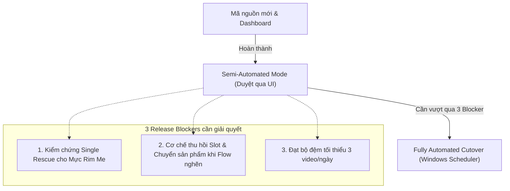

# BÁO CÁO TỔNG HỢP KIẾN TRÚC & MÃ NGUỒN PI/VF NEXT
**Dành cho Claude PM (Project Manager Review & Sign-off)**

- **Mốc đối chiếu:** 11/11/2026, 21:35 (Bangkok / Hanoi Time)
- **Git Branch:** `codex/unified-pipeline`
- **HEAD Commit:** [`5e26b34`](https://github.com/khoahuynhanh97/pi-vf-next/commit/5e26b341d70408cfdd48bbf851916ce1f2c15b8f) (`origin/codex/unified-pipeline`)
- **Trạng thái Repo:** Working tree clean, 100% code đã commit & push lên GitHub.
- **Tài liệu tham chiếu:** [`AGENTS.md`](../AGENTS.md), [`docs/PI-VF-HANDBOOK.md`](../PI-VF-HANDBOOK.md), [`docs/WORKLOG-2026-11-11.md`](../WORKLOG-2026-11-11.md).

---

## 1. Mục tiêu (Objectives) & Định hướng cốt lõi (Core Principles)

> [!IMPORTANT]
> **TÍNH CHẤT DỰ ÁN: CÔNG CỤ CÁ NHÂN & LÀM AFFILIATE MARKETING (CHẤP NHẬN SAI SÓT NHỎ)**
> - **Bản chất hệ thống:** Đây là công cụ cá nhân (solo-operator tool), phục vụ mục đích **sản xuất video POV làm affiliate marketing** (kéo view, giới thiệu sản phẩm để gắn link bán hàng / bio).
> - **Ưu tiên hàng đầu là tốc độ & sản lượng ra video hằng ngày (Speed & Output Volume):** Không yêu cầu độ hoàn hảo tuyệt đối như TVC thương mại hay quảng bá thương hiệu lớn.
> - **Chấp nhận sai sót nhỏ:** Các chi tiết phụ như phông nền, góc ánh sáng, hoặc khác biệt nhỏ về cách bài trí đều được chấp nhận, miễn là:
>   1. Video thể hiện đúng sản phẩm cốt lõi.
>   2. Không bị dính chữ/banner/watermark rác che mất sản phẩm.
>   3. Video phát được (MP4 dọc 9:16, PyAV decodable), receipt khớp file.
> - **Giữ QC ở mức `low`:** Tránh việc AI Critic hoặc bộ lọc kỹ thuật quá khắt khe làm `reject` hoặc dừng pipeline một cách không cần thiết.

### 1.1. Mục tiêu kinh doanh & Vận hành
1. **Tạo video POV bán hàng tự động:** Tự động hóa quy trình từ dòng dữ liệu trên Google Sheets → cào ảnh Shopee/TikTok qua Spaiauto → AI Vision thẩm định ảnh thật → sinh kịch bản POV 4 cảnh → sinh keyframe & render clip qua Google Flow → ghép, kiểm tra kỹ thuật và xuất MP4 dọc 9:16.
2. **Chỉ tiêu sản lượng:** Đạt tối thiểu **3 video POV MP4 hợp lệ/ngày** được chủ công cụ duyệt (`approve`), trần an toàn kỹ thuật là **20 video/ngày**.
3. **Chất lượng video:** Đúng sản phẩm, đúng biến thể, đúng thớ thịt/kết cấu thực tế, **không có chữ/watermark/banner Shopee/freeship rác** lơ lửng trong cảnh; chỉ giữ chữ in trên bao bì sản phẩm thực tế.

### 1.2. Nguyên tắc bất biến ([AGENTS.md](../AGENTS.md))
- **Move → Verify → Integrate → Automate → Optimize:** Giữ nguyên schema, ranh giới PI và VF, tránh viết lại hoặc thêm framework/abstraction không cần thiết.
- **Tập trung code thực chiến:** KHÔNG tự ý viết unit test, sinh file test hoặc tự động chạy test suite trừ khi người dùng yêu cầu rõ ràng.
- **Chính sách lỗi trong Daily Trigger:**
  - Sản phẩm `failed` giữ nguyên trạng thái, ghi rõ lý do và chuyển ngay sang sản phẩm tiếp theo khả thi.
  - Tối đa **1 lần cứu tự động (single rescue)** nếu là lỗi cục bộ có cách sửa trực tiếp (ví dụ tạo lại đúng keyframe sai hoặc ghép lại clip đạt chuẩn). Hết lượt cứu hoặc thiếu căn cứ thì chuyển sản phẩm.
  - Giữ mức QC `low`, xác minh đúng sản phẩm, MP4 phát được (PyAV decodable) và receipt khớp SHA256 file.

---

## 2. Phạm vi công việc (Scope)

| Hạng mục | Trong phạm vi (In-Scope đã thực hiện) | Ngoài phạm vi (Out-of-Scope cho Phase này) |
| :--- | :--- | :--- |
| **Dữ liệu đầu vào (Intake)** | - Bỏ ràng buộc kiểm tra giá affiliate.<br>- Hỗ trợ sản phẩm OCOP/đặc sản thiếu brand/model bằng cơ chế nhận diện qua ảnh thật (`identity_mode=source_product`).<br>- Vision thẩm định ảnh từ ZIP local. | - Tự động đồng bộ 2 chiều ngược lại Google Sheets.<br>- Xử lý tự động mọi biến thể phức tạp chưa có ảnh. |
| **Sáng tạo & Render (VF)** | - Nâng cấp Prompt 3 tầng (Director, Keyframe Provider, Scene Renderer) chống watermark, logo sàn, banner khuyến mãi.<br>- Render bằng Google Flow Provider thật. | - Tự động lồng giọng đọc TTS phức tạp, nhạc nền bản quyền.<br>- Tự động đăng tải trực tiếp lên TikTok/Facebook/YouTube. |
| **Vận hành & Giám sát** | - Xây dựng Web UI Dashboard cục bộ (`automation/dashboard.py`) tại cổng `8080` để xem video 9:16, xem lý do skip/fail, kéo thả upload ảnh sạch sửa lỗi, copy lệnh CLI 1-click. | - Hệ thống phân quyền nhiều người dùng (Multi-tenant, Auth/RBAC).<br>- Cloud hosting dashboard bên ngoài mạng local. |
| **Nghiệm thu** | - Xuất thành công MP4 POV thật 32s cho sản phẩm *Mứt mãng cầu sấy* ([`final.mp4`](file:///d:/work/pi-vf-next/runtime/vf/workspace/exports/export_proj-pv-daily-f1bb41ca374ce799_1/final.mp4)). | - Bật ngay scheduler chạy ngầm 100% mà chưa nghiệm thu ca cứu và ca fallback khi provider nghẽn. |

---

## 3. Chi tiết mã nguồn đã thay đổi (Code Changes Snapshot)

Toàn bộ thay đổi nằm trong commit [`5e26b34`](https://github.com/khoahuynhanh97/pi-vf-next/commit/5e26b341d70408cfdd48bbf851916ce1f2c15b8f):

```
apps/pi/tools/spaiauto/intake.py                      |  68 ++++++++++++-----
apps/pi/tools/spaiauto/scheduled.py                   |  32 +++++----
apps/vf/src/video_factory/automation/importer.py       |  34 ++++++---
apps/vf/src/video_factory/creative/agents/director.py |  18 ++++-
apps/vf/src/video_factory/integrations/google_flow_keyframe_provider.py |  16 +++-
apps/vf/src/video_factory/integrations/scene_renderer.py |  11 ++-
automation/cli.py                                     |  38 ++++++++++
automation/dashboard.py                               | 385 ++++++++++++++++++++++++++++++++++++++++++++++++++++++++++++++
docs/WORKLOG-2026-11-11.md                            | 152 +++++++++++++++++++++++++++++++++++++
docs/PI-VF-HANDBOOK.md                                |   9 ++
```

### Điểm nhấn kỹ thuật chính:
1. **[`apps/pi/tools/spaiauto/intake.py`](file:///d:/work/pi-vf-next/apps/pi/tools/spaiauto/intake.py#L302):**
   - Loại bỏ kiểm tra `price_min`/`price_max`.
   - Với sản phẩm OCOP/đặc sản thiếu `brand`/`model`, nếu ảnh local từ ZIP xác thực được sản phẩm thực tế, hệ thống gán fallback `model="Standard"`, `brand="Generic"` và đánh dấu `identity_mode="source_product"` để không bị chặn ở tầng tạo canonical key.
2. **[`apps/vf/src/video_factory/creative/agents/director.py`](file:///d:/work/pi-vf-next/apps/vf/src/video_factory/creative/agents/director.py#L251) & Providers:**
   - Bổ sung quy tắc bắt buộc: *"CRITICAL VISUAL CLEANLINESS: DO NOT generate any promotional text, marketing banners, price tags, Shopee frames, flash sale badges, discount icons, or watermarks... The scene must depict a real physical environment."*
   - Cập nhật `KEYFRAME_NEGATIVE_PROMPT` và `MANDATORY_VIDEO_NEGATIVE_PROMPT` với các từ khóa cấm: `text overlays, banners, logos, discount badges, watermarks, promotional borders`.
3. **[`automation/dashboard.py`](file:///d:/work/pi-vf-next/automation/dashboard.py):**
   - FastAPI app độc lập, stream trực tiếp video MP4 (hỗ trợ HTTP 206 Partial Content cho thanh tua video), xem thẻ sản phẩm theo ngày, upload ảnh bổ sung và copy lệnh CLI cho agent.

---

## 4. Bằng chứng thực nghiệm (Operational Evidence)

### 4.1. Sản phẩm xuất xưởng thành công qua Google Flow
- **Sản phẩm:** *Mứt mãng cầu sấy ít đường Hộp 500g* (`row_0015` từ Google Sheet).
- **Đường dẫn MP4:** [`runtime/vf/workspace/exports/export_proj-pv-daily-f1bb41ca374ce799_1/final.mp4`](file:///d:/work/pi-vf-next/runtime/vf/workspace/exports/export_proj-pv-daily-f1bb41ca374ce799_1/final.mp4)
- **Thông số kỹ thuật (PyAV verified):**
  - **Resolution:** 1080 × 1920 (chuẩn dọc 9:16).
  - **Frame rate:** 30 fps | **Duration:** 32.0s (960 frames).
  - **Dung lượng:** 12.4 MB | **Decodable:** `True`.
  - **SHA256:** `b17f94f71976915409479e4e562e781af6068dd4ca0ad5cbf378d0426022e51a` khớp chính xác `metadata.json`.

### 4.2. Trạng thái các sản phẩm trong đợt chạy:
- **`row_0006` (SEAVY Mực Rim Me Nha Trang):** Cảnh 1 và 4 đạt, nhưng Cảnh 2 và 3 bị lệch thớ mực (hiển thị giống mực khô nguyên con thay vì miếng mực ngào rim me). Đã đưa vào danh sách **chờ cứu 1 lần (Single Rescue)**.
- **Video 7 (Bánh chè lam Thạch Thất):** File test mock cũ, đã loại khỏi danh sách nghiệm thu.
- **`row_0009` (Kẹo dừa Bến Tre) & `row_0010` (Mứt gừng):** Bị skip ở bước intake do ảnh trên sàn chứa nhiều biến thể và khung sale che khuất. Có thể dùng UI Dashboard để nạp ảnh sạch chạy tiếp.

---

## 5. Đánh giá rủi ro & Release Blockers (Trước khi Full Cutover)



1. **Blocker 1 (Rescue test):** Cần chạy thực tế lệnh tạo lại keyframe cảnh 2–3 cho Mực Rim Me để kiểm chứng cơ chế thay thế cảnh hỏng mà không mất chi phí render lại toàn bộ video.
2. **Blocker 2 (Scheduler Resilience):** Nếu chạy ngầm 100% qua Windows Task Scheduler (`PI-VF Two Sheets 0630`), khi gặp provider rate-limit hoặc timeout, hệ thống cần đảm bảo tự giải phóng lease/slot và chuyển sang sản phẩm tiếp theo mà không dừng toàn bộ tiến trình.
3. **Blocker 3 (Sản lượng tối thiểu):** Hiện mới có 1 video mới đạt chuẩn hôm nay (Mứt mãng cầu sấy). Cần tối thiểu 3 video duyệt/ngày để đảm bảo nhịp vận hành.

---

## 6. Kế hoạch hành động đề xuất (Action Plan)

### Giai đoạn 1: Review & Duyệt kiến trúc (Claude PM)
- [ ] Claude PM review cấu trúc code tại commit [`5e26b34`](https://github.com/khoahuynhanh97/pi-vf-next/commit/5e26b341d70408cfdd48bbf851916ce1f2c15b8f).
- [ ] Phê duyệt giải pháp: Duy trì vận hành **Semi-Automated qua Dashboard** trước khi bật tự động hoàn toàn.

### Giai đoạn 2: Cứu sản phẩm & Hoàn thiện sản lượng (Thực thi ngay sau khi duyệt)
1. **Thực hiện cứu Sản phẩm 6 (Mực Rim Me Nha Trang):**
   - Áp dụng bộ prompt chống chữ mới, tạo lại keyframe Cảnh 2 và Cảnh 3.
   - Render lại 2 clip giữa và ghép lại `final.mp4`.
2. **Kích hoạt sản phẩm tiếp theo:**
   - Chọn thêm 1 sản phẩm có ảnh đạt chuẩn từ Sheet (hoặc upload ảnh sạch qua Dashboard cho Kẹo dừa/Mứt gừng) để xuất video thứ 3.
3. **Nghiệm thu ca lỗi tự chuyển sản phẩm:**
   - Xác nhận log: Sản phẩm lỗi ghi lý do riêng, không chặn pipeline, sản phẩm hợp lệ tiếp theo ra được MP4.

### Giai đoạn 3: Bật tự động hoàn toàn (Full Cutover)
- Kích hoạt Windows Task Scheduler sau khi cả 3 điều kiện nghiệm thu ở Giai đoạn 2 đạt 100%.

---

## 7. Các quyết định cần Claude PM xác nhận

1. **Đồng thuận tiêu chí đánh giá Affiliate (Chấp nhận sai sót nhỏ):** Thống nhất quan điểm đánh giá và review: đây là công cụ affiliate cá nhân thực chiến, không over-engineer hay cầu toàn thẩm mỹ như TVC thương hiệu lớn, ưu tiên tốc độ ra video hàng ngày và giữ QC `low`.
2. **Chấp thuận mô hình vận hành Semi-Automated qua Dashboard:** Đồng ý để người vận hành sử dụng Web UI Dashboard (`http://127.0.0.1:8080`) để duyệt video và can thiệp ảnh sạch trong giai đoạn đầu?
3. **Phê duyệt phương án cứu Sản phẩm 6:** Cho phép thực hiện 1 lần tạo lại cảnh 2 & 3 cho Mực Rim Me Nha Trang bằng Google Flow với prompt chống watermark mới?
4. **Tiêu chí cutover tự động:** Đồng ý chỉ kích hoạt Windows Task Scheduler chạy ngầm sau khi đã hoàn tất 3 video duyệt/ngày và nghiệm thu xong ca tự chuyển sản phẩm khi có lỗi?
